# 📱 Phonegames – Partyspiele fürs Handy

**Ein Handy. Die ganze Runde.** Phonegames ist eine Progressive Web App (PWA) mit 30 Spielen für das Mobiltelefon –
17 lustigen Gesellschaftsspielen für die ganze Runde, 5 Spielen für Kinder allein und 8 Spielen in 3D ab 13 – und
einem eigenen Bereich zum Lernen. Konto erstellen, Spiele entdecken, Spielgruppe anlegen – und los geht’s. Nach der
Anmeldung funktioniert alles **auch offline**.

Mit dabei: vom tickenden Klassiker **💣 Bombe** über Bluff-Spiele wie **🕵️ Spion unter uns** und **🐺 Nachts im Dorf**
(mit Erzählstimme) bis zu Team-Ratespielen, Schätzfragen und kleinen Helfern wie dem **☝️ Zufallsfinger**. Allein geht
es mit **🏎️ Phoni-Rennen** oder **🧠 Memo-Blitz**, in der **Arena** mit **🎿 Pistenjagd** oder **⛳ Golfinsel** in 3D.
Im Tab **📝 Lernen** wird Schulstoff zum Spiel: Wörtliblatt fotografieren, eine KI in der Schweiz macht Lernkarten daraus –
und unter «Aufgaben» Tests und Probeprüfungen für grössere Themen.

<p align="center">
  
  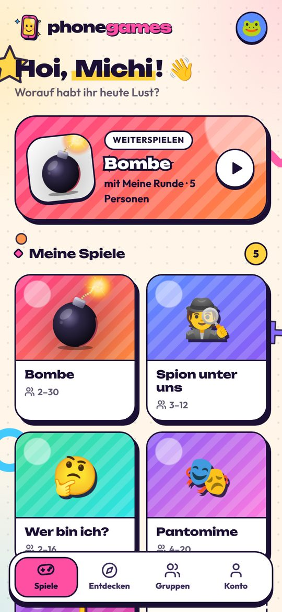
  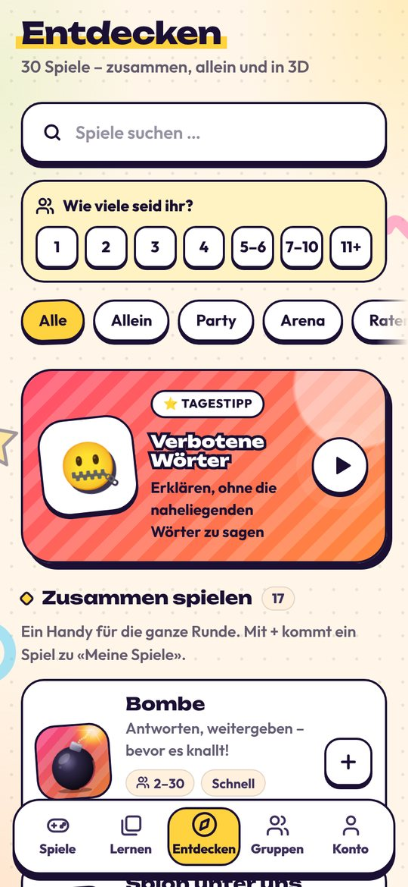
  
</p>
<p align="center">
  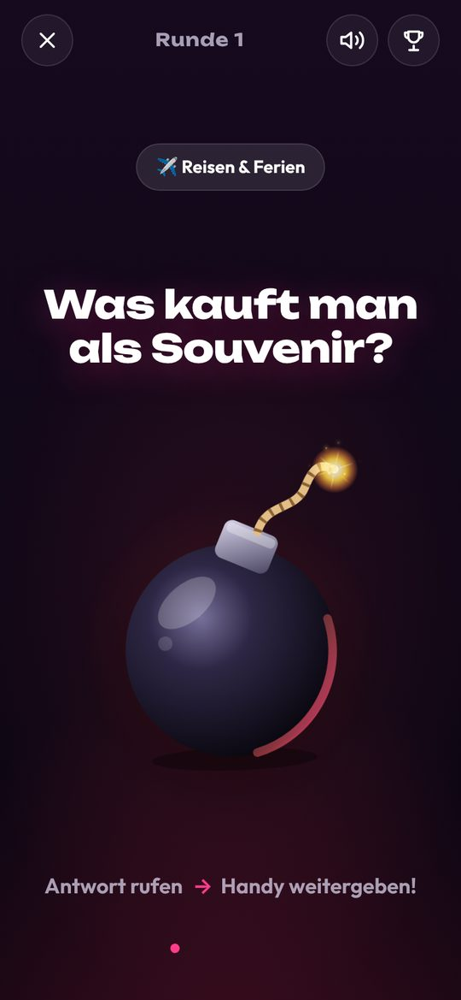
  
  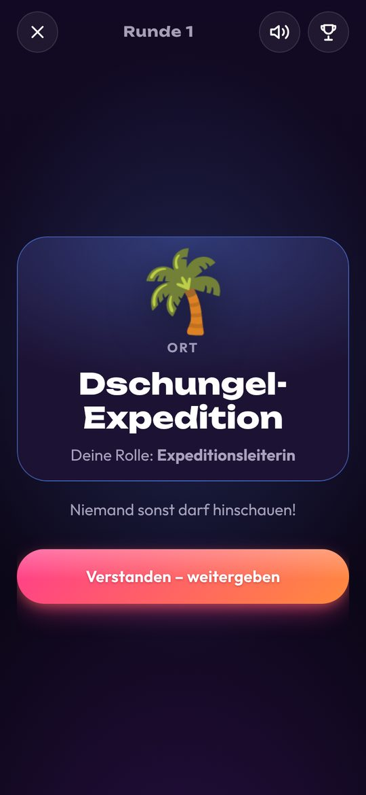
  
</p>
<p align="center">
  
  
  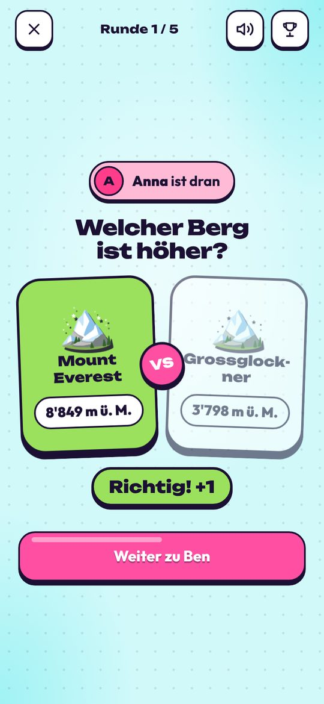
  
</p>
<p align="center"><b>🎮 Allein spielen und Arena in 3D</b></p>
<p align="center">
  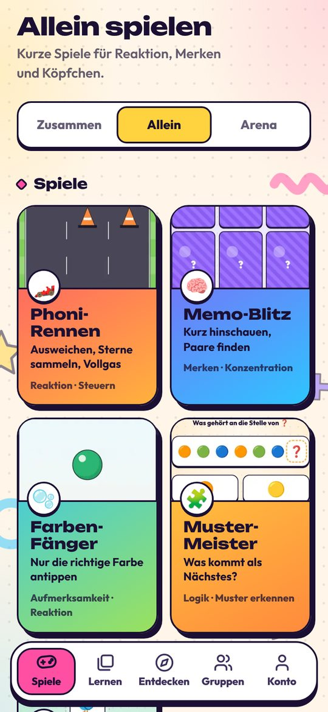
  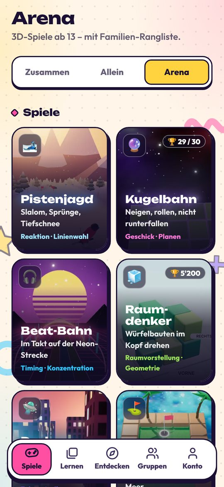
  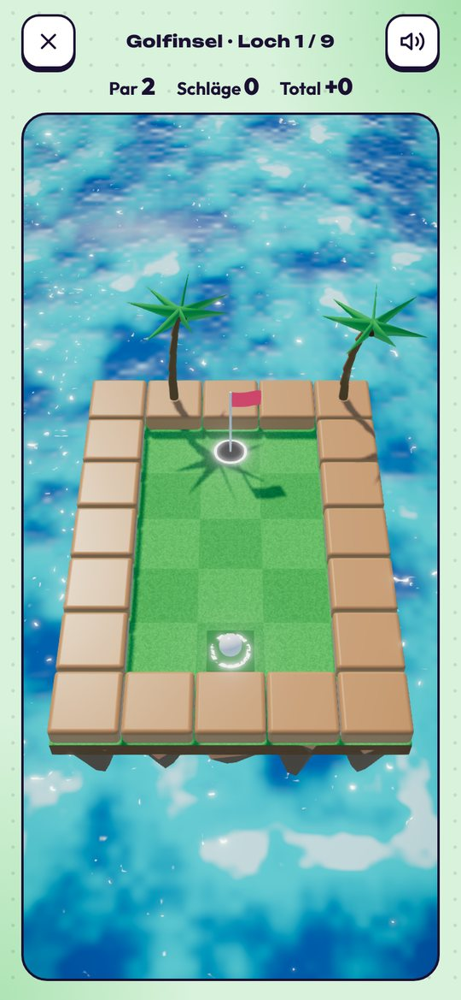
  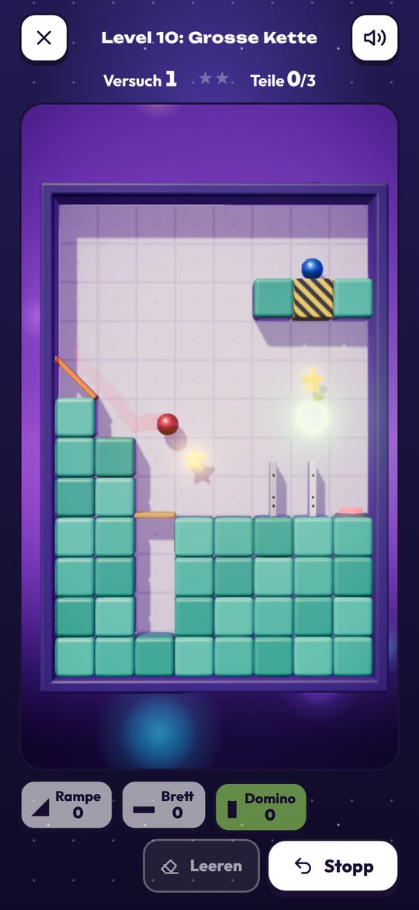
</p>
<p align="center"><b>📝 Lernen – Schulstoff als Spiel</b></p>
<p align="center">
  
  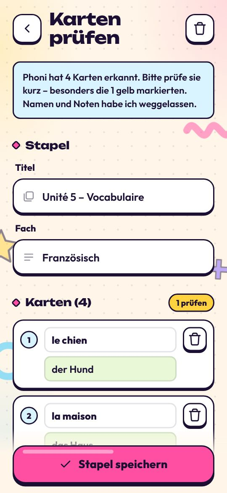
  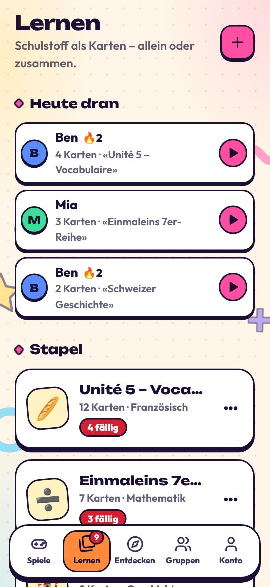
  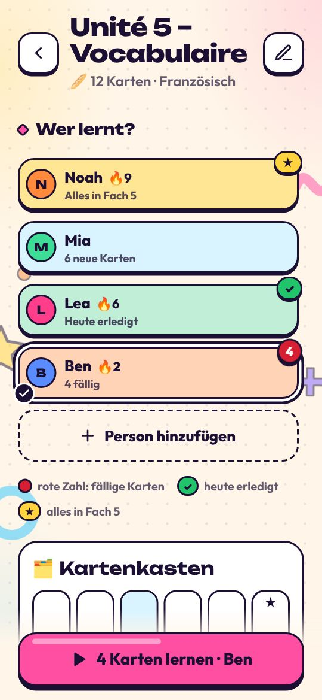
</p>
<p align="center">
  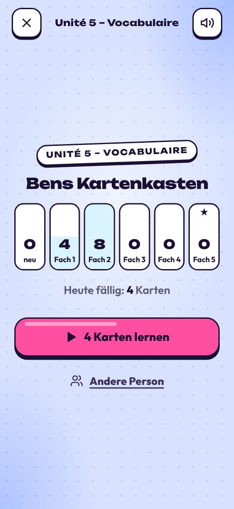
  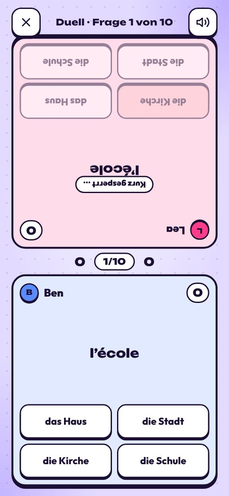
  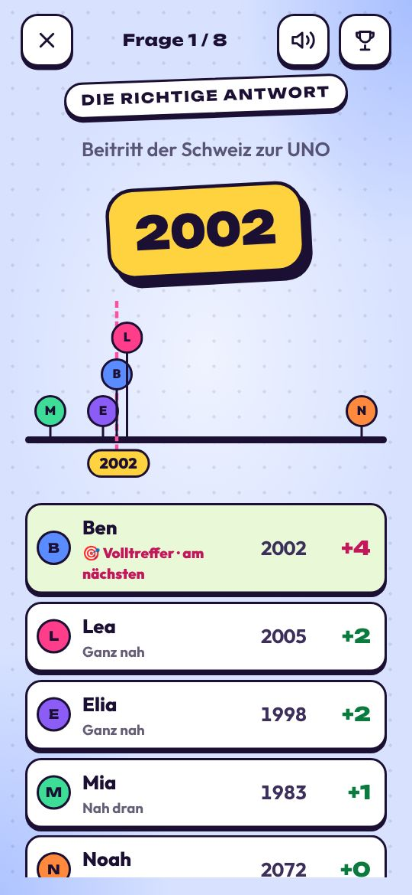
  
</p>

## Funktionen

| Bereich | Was es kann |
| --- | --- |
| **Start** | Willkommensseite mit den drei Teilen der App (Partyspiele, Allein & 3D, Lernen) · «Weiterspielen» mit dem zuletzt gespielten Spiel und der Gruppe · kompakte Kacheln für «Meine Spiele» – neue Konten sehen stattdessen «Zum Start» mit sechs sofort spielbaren Spielen · Vorschläge zum direkten Hinzufügen |
| **Konto** | Registrieren mit Name, E-Mail und Passwort – kostenlos mit Einladungscode (auch als Link `/registrieren?code=…`) oder mit **Jahresabo** über Stripe (7 Tage gratis, danach CHF 5 pro Jahr; TWINT, Apple Pay, Google Pay, Karte; verwalten und kündigen im Stripe-Kundenportal). Das Abo ist fertig, aber erst mit dem Secret `STRIPE_SECRET_KEY` eingeschaltet – vorerst ist es aus, neue Konten brauchen einen Einladungscode · Zustimmung zu Nutzungsbedingungen und Datenschutzerklärung (auch für bestehende Konten, erneut bei Änderungen) – aktiv, sobald die Betreiberangaben eingetragen sind · öffentliche Seiten Impressum, AGB, Datenschutz · Anmelden/Abmelden · **Passkeys** (Face ID, Fingerabdruck, Geräte-PIN) einrichten, verwalten und damit anmelden – Hinweis auf dem Startbildschirm, der sich dauerhaft wegklicken lässt · Name, E-Mail, Avatar (Emoji + Farbe) und Passwort ändern · Datenexport (JSON) · Konto löschen |
| **Entdecken** | Alle 30 Spiele an einem Ort («30 Spiele – zusammen, allein und in 3D») · ohne Filter «⭐ Tagestipp» und drei Abschnitte mit Anzahl: «Zusammen spielen» (17, mit + zu «Meine Spiele» hinzufügen/entfernen), «Allein spielen» (5) und «Arena» (8) – diese mit Bild aus dem Spiel; ein Tipp öffnet ihre Seite (`/allein/…`, `/arena/…`), «Zurück» führt wieder zu Entdecken · Filter «Wie viele seid ihr?» ab **1** (allein: die Spiele von «Allein» und «Arena» und Gruppenspiele, die auch eine Person spielen kann, z. B. «Mehr oder weniger») · Volltextsuche (umlaut-tolerant, auch nach dem, was ein Spiel übt) und Kategorien, darunter «Allein» und «Arena» – mit Suche oder Filter eine gemeinsame Liste «N Spiele gefunden» · haben die Eltern die Arena ausgeblendet, fehlt sie auch hier (22 Spiele) |
| **Spielgruppen** | Gruppen mit Namen, Symbol und Mitspielenden anlegen · beim Spielstart wird die Gruppe angezeigt und kann direkt angepasst werden (Personen hinzufügen/entfernen) |
| **Spiele** | Oben «Zusammen \| Allein \| Arena» (der Tab öffnet den zuletzt benutzten Bereich) · 17 Partyspiele mit über 2’500 Begriffen, Fragen und Karten · **Allein spielen:** 5 Spiele für eine Person von 6 bis 12 Jahren mit zwei Altersstufen, Rekorden pro Person und – im Phoni-Rennen – Autos zum Kaufen · **Arena:** 8 Spiele in 3D für Jugendliche ab 13 (three.js, erst beim Spielen geladen) mit Leuchteffekten, Spiegelungen und Partikeln – «Grafik: Automatisch / Schön / Schnell» passt sie dem Handy an –, Skins, Eltern können sie ausblenden · **Familien-Rangliste** für alle Einzelspiele und die Gemeinschaftsspiele mit Wertung (Punkte pro Person, Siege, Partien – in Teamspielen zählt, wer erklärt oder darstellt) – siehe Tabellen unten |
| **Belohnungen** | Münzen fürs Lernen, ein- und ausschaltbar (Konto → Belohnungen): pro gewusste Karte im Kartenkasten und Lückentext und pro Punkt in Aufgaben, mit Tageslimit · eine Runde «Allein spielen», Autos im Phoni-Rennen und Skins der Arena kosten Münzen (mit Münzen aus ist alles frei) · Arena ein- oder ausblenden · Kontostand pro Person mit Verlauf, Münzen schenken oder abziehen · Einstellungen mit Code schützen (Code vergessen → Passwort des Kontos) · passt für Eltern jüngerer Kinder; Jugendliche mit eigenem Konto lassen es aus oder nutzen es als eigenen Ansporn · Münzen gehen beim Synchronisieren nie verloren (Zähler pro Gerät) |
| **Lernen** | Eigener Bereich (Tab, mit rotem Badge für alle fälligen Karten), kein Spiel im Katalog · Spielformen: **Kartenkasten** (Lernkartei mit 5 Fächern, Lernstand und Lernserie pro Person, allein ohne Spielgruppe; Lernstand pro Stapel als farbiger Balken, «Diese Woche» mit den Lerntagen jeder Person; aufdecken, Auswahl aus vier oder eintippen; Wörtli wie erfasst, umgekehrt oder gemischt abfragen), **Lückentext** (Wortbank oder eintippen), **Duell** (zu zweit, geteilter Bildschirm), **Blitzrunde** (Teams, eine Person fragt ab), **Schätzrunde** (Zahlen und Jahreszahlen, alle schätzen geheim) · «Heute dran» (wer welche Karten wiederholen soll, ein Tipp startet die erste Karte) und alle Stapel · Stapelseite mit «Wer lernt?» (ohne Spielgruppe, Personen hinzufügen und entfernen), Kartenkasten mit Fächern und Antwortart pro Person, Lückentext und den Spielformen zum Zusammenspielen · Lernstoff per Foto erfassen (bis 6 Seiten; Auswertung mit einem Qwen-Modell bei Infomaniak in der Schweiz, Fotos werden nicht gespeichert) oder abtippen · erkannte Karten prüfen und korrigieren · Monatslimit pro Person · Stapel und Lernstand werden synchronisiert · **per Link teilen** (Vorschau für alle mit dem Link; Empfänger übernehmen eine eigene Kopie, wer noch kein Konto hat, registriert sich zuerst) |
| **Aufgaben** | Zweiter Bereich im Tab «Lernen» («Karten \| Aufgaben») für die Prüfungsvorbereitung · Thema mit Lernzielen und Kernstoff aus Fotos (Lernziel-Blatt, Buchseiten) oder Stichworten, passend zur Stufe (Lehrplan 21), oder selbst geschrieben · Prüfungsdatum (steht in den letzten 7 Tagen in «Heute dran») · **Unterlagen** von der KI: Wissenstest, Übungsaufgaben oder Probeprüfung (15/30/45 Minuten, drei Schwierigkeiten, ausgewählte Lernziele), mit Musterlösungen und zweiter Kontrolle · Vorschau mit/ohne Lösungen, **PDF** zum Ausdrucken (Häuschen in Mathe, Lösungen auf eigener Seite, Notenskala) · **in der App lösen** mit Notizblatt für Finger und Stift (iPad), Auswertung und Selbstbewertung · Ergebnisse vom Papier eintragen · Stand pro Lernziel («sitzt», «fast», «üben») und «Gezielt üben» · Lernkarten aus einem Thema · 20 Unterlagen pro Monat |
| **Sound & Stimme** | Eigenes Sounddesign pro Spiel (Trommelwirbel, Herzschlag, Fanfaren …, alles synthetisiert) · natürliche Erzählstimmen «Thorsten» und «Kerstin» vom eigenen Server (Piper) – auf jedem Gerät gleich, auch auf dem iPhone, Ansagen offline verfügbar; sonst die beste Stimme des Geräts · Stimmenauswahl mit Hörprobe unter Konto → Erzählstimme |
| **PWA** | Installierbar (Android & iOS) · komplett offline spielbar · Offline-Änderungen werden automatisch synchronisiert · Update-Hinweis bei neuer Version · Bildschirm bleibt während des Spiels an |

## Die Spiele

| Spiel | Personen | Worum es geht |
| --- | --- | --- |
| 💣 **Bombe** | 2–30 | Frage beantworten, Handy weitergeben – bis es knallt. Geheime Zündzeit, Ticken wird schneller, Partikel-Explosion. 300+ Fragen |
| 🕵️ **Spion unter uns** | 3–12 | Alle kennen geheim den Ort – nur der Spion nicht. Fragen stellen, bluffen, entlarven. 56 Orte mit Rollen |
| 🪞 **Doppelgänger** | 3–16 | Alle haben dasselbe Wort, einer ein ähnliches. Wer fällt auf? 179 Wortpaare, «Ahnungslos»-Modus |
| 🐺 **Nachts im Dorf** | 5–20 | Werwolf-Spiel – das Handy ist Spielleitung und führt mit Sprachausgabe durch die Nacht. Seherin & Beschützer, Rollen bleiben bis zum Schluss geheim |
| 🤔 **Wer bin ich?** | 2–16 | Handy an die Stirn, die anderen erklären. Kippen = erraten/passen (Bewegungssensor). 9 Themen, 500+ Begriffe |
| 🎭 **Pantomime** | 4–20 | Teams, Zeitlimit, drei Schwierigkeitsstufen. 311 Begriffe |
| 🤐 **Verbotene Wörter** | 4–20 | Erklären ohne die fünf naheliegenden Wörter – mit Buzzer fürs Gegnerteam. 210 Karten |
| 🎩 **Hutspiel-Marathon** | 4–20 | Eigene Begriffe, drei Runden: erklären, ein Wort, Pantomime |
| 🎨 **Zeichnen & Raten** | 3–16 | Mit dem Finger zeichnen, die anderen raten. Farben, Pinsel, Radierer, Rückgängig. 307 Begriffe |
| 🎵 **Summ-Raten** | 4–20 | Lieder summen, das Team rät. 267 Lieder von Kinderliedern bis Mundart-Hits |
| 🎯 **Schätzmeister** | 2–12 | Geheim schätzen, spannende Auflösung, Punkte für die Nächsten. 102 Fragen |
| ⚖️ **Mehr oder weniger** | 1–12 | Matterhorn oder Kilimandscharo – was ist höher? 15 Themen mit geprüften Werten |
| 👉 **Wer würde eher …?** | 3–30 | Auf «3» zeigen alle auf eine Person. 170 Fragen in drei Paketen |
| 🔥 **Wahrheit oder Pflicht** | 2–20 | Roulette wählt, Wahrheit oder Pflicht? 192 Karten, Pakete von Familie bis Party |
| 🙋 **Ich hab noch nie …** | 3–30 | Wer schon hat, steht auf – mit Strichliste. 168 Aussagen |
| ☝️ **Zufallsfinger** | 2–10 | Alle Finger aufs Display: eine Person, zwei Teams oder eine Reihenfolge auslosen |
| 🍾 **Flaschendrehen** | beliebig | Wischen und drehen lassen – auf Wunsch mit Wahrheit-oder-Pflicht-Karte |

### Allein spielen

| Spiel | Übt | Worum es geht |
| --- | --- | --- |
| 🏎️ **Phoni-Rennen** | Reaktion, Steuern | Strasse von oben: Spur wechseln per Tipp, Pylonen, Öl und Gegenverkehr ausweichen, Sterne sammeln – immer schneller. 3 bzw. 4 Spuren, vier Autos (Blitz, Monstertruck, Rakete gegen Münzen) |
| 🧠 **Memo-Blitz** | Merken, Konzentration | Alle Karten kurz offen, dann Paare finden – 12 bzw. 20 Karten, Punkte für wenige Züge und Tempo |
| 🫧 **Farben-Fänger** | Aufmerksamkeit, Reaktion | Nur Blasen der gesuchten Farbe antippen, die Farbe wechselt; für 8–12 mit Farbwörtern als Ablenkung |
| 🧩 **Muster-Meister** | Logik | Was kommt an die Stelle von ❓? Farben, Formen, Drehpfeile und Zahlenreihen, 10 Reihen pro Runde |
| 🛝 **Sortier-Rutsche** | Einordnen, Tempo | Links oder rechts sortieren, bevor es unten ist: Obst/Gemüse, Land/Wasser … bzw. gerade/ungerade, Nomen/Verb, Säugetier, Kanton |

### Arena (3D, ab 13)

| Spiel | Übt | Worum es geht |
| --- | --- | --- |
| 🎿 **Pistenjagd** | Reaktion, Linienwahl | Abfahrt durch eine immer neue Berglandschaft: Slalomtore, Schanzen, Tannen und Felsen, Tiefschnee bremst. Pisten Blau (klarer Morgen), Rot (Abendrot), Schwarz (Nacht mit Polarlicht und Helmlampe); der Geist fährt die eigene Bestfahrt. Finger oder Handy neigen |
| 🔮 **Kugelbahn** | Geschick, Planen | Kugel durch schwebende Labyrinthe ins Ziel: Abgründe, Beschleuniger, Schalter und Tore, Kontrollpunkte. 30 Level (5 von Hand, 25 erzeugt und auf Lösbarkeit geprüft), Bestzeit pro Level |
| 🎧 **Beat-Bahn** | Timing, Konzentration | Rhythmusspiel auf einer Neon-Strecke mit 4 Spuren. Die Songs (Pop, House, Chip) erzeugt die App selbst – Schlagzeug, Bass, Akkorde, Melodie; Bild und Bewertung laufen auf der Audio-Uhr |
| 🧊 **Raumdenker** | Raumvorstellung | Würfelbauten drehen: Welche Ansicht von oben/vorne/rechts? Wie viele Würfel? Gleich gedreht oder Spiegelbild? 12 Aufgaben pro Runde |
| 🚁 **Drohnen-Parcours** | Feinmotorik, Orientierung | Durch leuchtende Tore fliegen – Stadt, Wald oder Halle; «Einfach» mit einem Daumen (die Drohne fliegt von selbst vorwärts), «Profi» mit zwei Daumen wie bei einer echten Drohne. Pfeil zum nächsten Tor, Geist der Bestzeit |
| ⛳ **Golfinsel** | Kraft dosieren, Winkel | Minigolf auf schwebenden Inseln (Sonneninsel über türkisfarbenem Meer, Vulkaninsel über glühender Lava; je 9 Löcher): Banden, Sand, Förderbänder, Windmühlen, Schanzen über Lücken. Zurückziehen und loslassen |
| 🪐 **Orbit** | Physik-Gespür, Knobeln | Sonde wie mit einer Steinschleuder starten, die Schwerkraft der Planeten lenkt sie in Bögen zum Zielring; die Vorschau zeigt nur den Anfang der Bahn. 20 Level (5 von Hand, 15 erzeugt und auf Lösbarkeit geprüft) |
| 🧩 **Kettenreaktion** | Ursache und Wirkung, Kreativität | Physik-Rätsel im Guckkasten: Rampen, Federn, Bretter und Dominosteine setzen, dann die Kugel loslassen – mit Schaltern, Toren und einer zweiten Kugel. 10 Level, jedes mit einer geprüften Lösung; übrige Teile und Sterne geben Extrapunkte, Tipps nach zwei Versuchen |

Alle Inhalte sind in Schweizer Hochdeutsch geschrieben (ohne «ß») und funktionieren offline.

## Design & Marke

- **Phoni**, das fröhliche Handy-Maskottchen, ist Logo und Gastgeber zugleich: Es begrüsst, staunt bei leeren Listen,
  feiert mit Partyhut und schaut verdutzt, wenn etwas schiefgeht ([`client/src/components/Brand.tsx`](client/src/components/Brand.tsx)).
- **Sticker-Pop-Look:** warmes Creme-Papier mit Punktraster, kräftige Farben, dicke Konturen, harte Schatten,
  leicht schräge «Sticker»-Elemente und schwebende Formen im Hintergrund
  ([`client/src/styles/global.css`](client/src/styles/global.css)).
- **Jeder Bereich hat seine Farbe:** Spiele Pink, Lernen Orange, Entdecken Gelb, Gruppen Blau, Konto Grün – als
  Markerstrich unter dem Titel, in den Abschnittsmarken und als Tönung des Hintergrunds. Die Umschalter
  «Zusammen | Allein | Arena» und «Karten | Aufgaben» bleiben beim Wechseln an derselben Stelle.
- **Knöpfe zum Draufdrücken:** Alles Klickbare senkt sich beim Antippen spürbar ein – mit Vibration und Sound.
  Kacheln neigen sich dabei zum Finger.
- **Bewegung mit Sinn:** Ein Spiel startet als Farbflut in seinen Farben, das Bild des angetippten Spiels fliegt in
  seine Startkarte, Tabs gleiten zur Seite. Die grossen Karten glänzen wie Sticker im Licht, Phoni schaut dem
  Finger nach und springt, wenn man ihn antippt. Wer im System «Bewegung reduzieren» eingestellt hat, bekommt
  davon nichts.
- **Nie verloren:** Eine neue Seite beginnt oben, «Zurück» führt an die Stelle zurück, an der man die Liste verlassen
  hat. Der grosse Knopf unten ist nie ausgegraut, sondern führt zu dem, was noch fehlt.
- **Für kleine Handys gemacht:** Titel passen sich der Kartenbreite an, jede Tippfläche ist mindestens 44 px gross,
  Meldungen erscheinen unten beim Daumen. Neue Konten sehen sofort sechs Spiele zum Start statt einer leeren Liste.
- **Bilder aus den Spielen:** Die Kacheln von «Allein» und «Arena» und ihre Einträge in «Entdecken» zeigen echte Aufnahmen der Spiele; Ranglisten
  stehen auf einem Podest.
- **Spiele:** helle, farbige Bühnen pro Spiel; bewusst dunkel sind nur die Nacht im Dorf und der Knall der Bombe.

## Technik

- **Frontend:** React 19, TypeScript, Vite 8, React Router 7, Zustand, `vite-plugin-pwa` (Workbox)
- **3D (Arena):** three.js mit Nachbearbeitung (Bloom, Vignette, FXAA) und eigenen Shadern für Himmel, Wasser und Partikel – in einem eigenen Teil des Bundles, den nur die Arena-Spiele laden
- **PDF:** pdfmake im Browser (Unterlagen in «Aufgaben», erst bei Bedarf geladen)
- **Backend:** Node.js 24, Fastify 5, SQLite über das eingebaute `node:sqlite` (keine nativen Abhängigkeiten), Zod
- **Sound & Effekte:** Web Audio API (alle Sounds werden zur Laufzeit erzeugt), Erzählstimme mit [Piper](https://github.com/OHF-Voice/piper1-gpl) im eigenen Container bzw. Web Speech API, Canvas (Explosion, Konfetti, Zeichenfläche, Phoni-Rennen), WebGL, CSS-Animationen, View Transitions
- **Geräte-APIs:** Bewegungssensor (Kipp-Steuerung), Multi-Touch, Pointer Events mit Stift-Druck (Notizblatt), Vibration, Wake Lock, Kamera/Fotos (Lernstapel, Aufgaben)
- **KI:** Foto-Auswertung für Lernstapel und Lernziele, Unterlagen und Lernkarten für «Aufgaben» über die OpenAI-kompatible Schnittstelle der Infomaniak AI Tools (Rechenzentren in der Schweiz), festes JSON-Schema
- **Zahlungen:** Stripe (Jahresabo, ohne Webhooks) – vorbereitet, eingeschaltet erst mit `STRIPE_SECRET_KEY`
- **Betrieb:** Docker, Caddy (automatisches HTTPS mit Let’s Encrypt), GitHub Actions → GitHub Container Registry → Infomaniak VPS

## Schnellstart (Entwicklung)

Voraussetzung: **Node.js ≥ 22.18** (empfohlen: 24, siehe `.nvmrc`).

```bash
npm ci
```

```bash
npm run dev
```

Danach läuft die App auf <http://localhost:5173> (Vite mit Hot Reload), die API auf Port 3000. Vite leitet `/api` automatisch an die API weiter.
Die SQLite-Datenbank liegt in `./data/phonegames.db`.

Produktionsbuild lokal testen (inkl. Service Worker / Offline-Modus):

```bash
npm run preview
```

→ <http://localhost:3000>

### Skripte

| Befehl | Zweck |
| --- | --- |
| `npm run dev` | API-Server (mit Watch) + Vite-Dev-Server |
| `npm run build` | PWA nach `dist/client` bauen |
| `npm start` | Produktionsserver starten (liefert API **und** PWA aus) |
| `npm run preview` | Build + Produktionsserver |
| `npm test` | Tests (Vitest): API, Sync-Logik, Münzen, Spiellogik (auch «Allein» und «Arena») und Inhalte |
| `npm run test:e2e` | Browser-Tests (Playwright): baut die App und spielt die wichtigsten Abläufe auf einem Handy-Bildschirm durch – siehe [`e2e/`](e2e) |
| `npm run typecheck` | TypeScript-Prüfung |
| `npm run icons` | App-Icons aus `client/public/icons/phoni.svg` neu erzeugen |

## Projektstruktur

```
├── client/                 PWA (React)
│   ├── public/             Icons, Favicon, covers/ (Bilder der Spiele von «Allein» und «Arena», WebP)
│   └── src/
│       ├── components/     UI-Bausteine (Buttons, Sheets, Roulette, Spieler-Editor, Rangliste, Lernstand …)
│       ├── games/          Spiele für die Runde – je Spiel ein Ordner + registry.ts
│       │   ├── shared/     Spielrahmen, Timer, Weitergeben & Aufdecken, Teams, Team-Engine, Punkte pro Person …
│       │   ├── bombe/      Fragen, Logik, Timer, Sounds, Explosion, Grafik
│       │   ├── spickzettel/ Spielformen von «Lernen» (Kartenkasten, Lückentext, Duell …) – kein Spiel im Katalog
│       │   └── …           16 weitere Spiele mit Logik und Inhalten
│       ├── solo/           «Allein spielen» – registry.ts, logic.ts (Regeln, getestet), je Spiel ein Ordner
│       ├── arena/          «Arena» (3D) – engine.ts (three.js, Nachbearbeitung), fx.ts (Himmel, Meer, Partikel …), input.ts, Regeln je Spiel (logic/beat/raum/drone/golf/orbit/chain.ts, getestet), je Spiel ein Ordner
│       ├── legal/          Impressum, AGB, Datenschutz – Betreiberangaben in operator.ts
│       ├── lib/            API-Client, Sync, Audio, Konfetti, PWA, Geräte-APIs, Lernen, Rangliste, PDF
│       ├── pages/          Seiten (Willkommen, Start, Allein, Arena, Lernen, Aufgaben, Entdecken, Gruppen, Konto, Belohnungen, Spiel)
│       ├── store/          Zustand-Stores (Auth, Daten, Einstellungen, Unterlagen, UI)
│       └── styles/         Design-System (CSS)
├── server/                 API (Fastify + SQLite)
│   ├── src/                app.ts, routes/, repo.ts (Datenbank), billing.ts (Stripe), security.ts …
│   └── test/               API-Tests (mit Schein-KI und Stripe-Attrappe)
├── e2e/                    Browser-Tests (Playwright) mit eigenem Testserver, Schein-KI und Stripe-Attrappe
├── shared/                 Typen, Sync-Logik, Münzen (coins.ts) und Version der Rechtstexte (legal.ts) für Client und Server
├── tts/                    Erzählstimme (Piper) – eigenes Docker-Image
├── scripts/                Dev-Start, App-Icons erzeugen
├── deploy/                 docker-compose.yml, Caddyfile, setup-vps.sh, backup.sh, .env.example
├── docs/                   Dokumentation
├── .github/workflows/      CI und Deployment
└── Dockerfile
```

## Deployment

Jeder Push auf `main` wird getestet, als Docker-Image in die GitHub Container Registry gepusht und per SSH auf den
Infomaniak-VPS ausgerollt. Die Schritt-für-Schritt-Anleitung (VPS bestellen, DNS, SSH-Schlüssel, GitHub-Secrets,
Rechtstexte, Abo, KI, Backups, Rollback) steht in **[docs/DEPLOYMENT.md](docs/DEPLOYMENT.md)**.

## Weitere Dokumentation

- [docs/DEPLOYMENT.md](docs/DEPLOYMENT.md) – Infomaniak-VPS einrichten und mit GitHub Actions ausrollen
- [docs/ARCHITEKTUR.md](docs/ARCHITEKTUR.md) – Aufbau, Offline-Synchronisation, Sicherheit, Rechtstexte, API, Allein und Münzen, Arena (3D-Grafik), Familien-Rangliste
- [docs/SPIELE.md](docs/SPIELE.md) – Ein neues Spiel hinzufügen (auch für «Allein» und «Arena») · Bausteine · Inhalte ergänzen
- [e2e/README.md](e2e/README.md) – Browser-Tests
- [docs/KONZEPT-LERNSTAPEL.md](docs/KONZEPT-LERNSTAPEL.md) – Konzept und Etappen von «Lernen» (früher «Spickzettel»)
- [docs/KONZEPT-AUFGABEN.md](docs/KONZEPT-AUFGABEN.md) – Konzept und Etappen von «Aufgaben» (Prüfungsvorbereitung)
