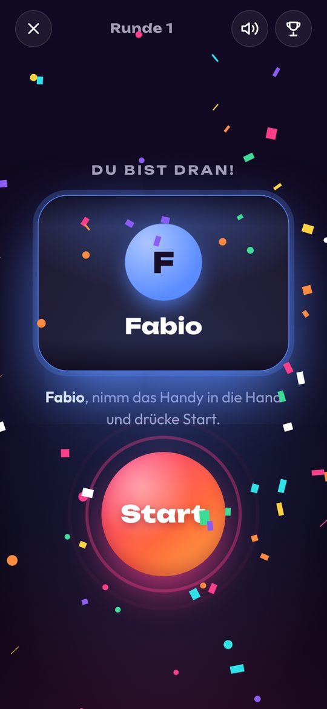
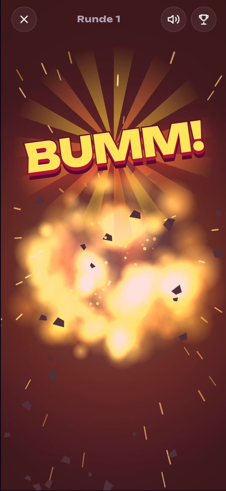
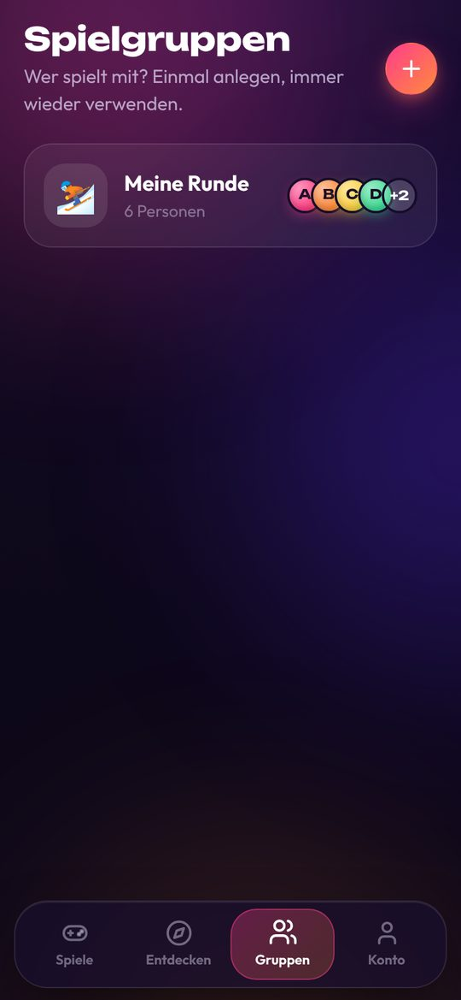

# 🎉 Plausch – Partyspiele fürs Handy

**Plausch** ist eine Progressive Web App (PWA) mit lustigen, einfachen Gesellschaftsspielen für das Mobiltelefon.
Konto erstellen, Spiele entdecken, Spielgruppe anlegen – und los geht’s. Nach der Anmeldung funktioniert alles **auch offline**.

Das erste Spiel ist **💣 Bombe**: Eine Frage erscheint, die Bombe tickt, das Handy wandert von Hand zu Hand – wer es hält, wenn es knallt, hat verloren.

<p align="center">
  
  
  
  
</p>
<p align="center">
  
  
  
  
</p>

## Funktionen

| Bereich | Was es kann |
| --- | --- |
| **Konto** | Registrieren mit Name, E-Mail und Passwort · Anmelden/Abmelden · Name, E-Mail, Avatar (Emoji + Farbe) und Passwort ändern · Datenexport (JSON) · Konto löschen |
| **Entdecken** | Spielkatalog mit Volltextsuche (umlaut-tolerant) und Filter-Chips · Spiele mit einem Tipp zu «Meine Spiele» hinzufügen/entfernen |
| **Spielgruppen** | Gruppen mit Namen, Symbol und Mitspielenden anlegen · beim Spielstart wird die Gruppe angezeigt und kann direkt angepasst werden (Personen hinzufügen/entfernen) |
| **Bombe** | Zufälliger Startspieler mit Roulette-Animation · über 300 Fragen in 10 Kategorien (Schweizer Rechtschreibung) · geheime, zufällige Zünddauer · Ticken, das gegen Ende schneller wird · synthetisierte Sounds · Partikel-Explosion mit Schockwelle, Screen-Shake und Vibration · Bomben-Bilanz pro Runde |
| **PWA** | Installierbar (Android & iOS) · komplett offline spielbar · Offline-Änderungen werden automatisch synchronisiert · Update-Hinweis bei neuer Version · Bildschirm bleibt während des Spiels an |

## Technik

- **Frontend:** React 19, TypeScript, Vite 8, React Router 7, Zustand, `vite-plugin-pwa` (Workbox)
- **Backend:** Node.js 24, Fastify 5, SQLite über das eingebaute `node:sqlite` (keine nativen Abhängigkeiten), Zod
- **Sound & Effekte:** Web Audio API (alle Sounds werden zur Laufzeit erzeugt), Canvas-Partikelsystem, CSS-Animationen, View Transitions
- **Betrieb:** Docker, Caddy (automatisches HTTPS mit Let’s Encrypt), GitHub Actions → GitHub Container Registry → Infomaniak VPS

## Schnellstart (Entwicklung)

Voraussetzung: **Node.js ≥ 22.18** (empfohlen: 24, siehe `.nvmrc`).

```bash
npm ci
```

```bash
npm run dev
```

Danach läuft die App auf <http://localhost:5173> (Vite mit Hot Reload), die API auf Port 3000. Vite leitet `/api` automatisch an die API weiter.
Die SQLite-Datenbank liegt in `./data/plausch.db`.

Produktionsbuild lokal testen (inkl. Service Worker / Offline-Modus):

```bash
npm run preview
```

→ <http://localhost:3000>

### Skripte

| Befehl | Zweck |
| --- | --- |
| `npm run dev` | API-Server (mit Watch) + Vite-Dev-Server |
| `npm run build` | PWA nach `dist/client` bauen |
| `npm start` | Produktionsserver starten (liefert API **und** PWA aus) |
| `npm run preview` | Build + Produktionsserver |
| `npm test` | Tests (Vitest): API, Sync-Logik, Spiellogik |
| `npm run typecheck` | TypeScript-Prüfung |
| `npm run icons` | App-Icons aus `client/public/favicon.svg` neu erzeugen |

## Projektstruktur

```
├── client/                 PWA (React)
│   ├── public/             Icons, Favicon
│   └── src/
│       ├── components/     UI-Bausteine (Buttons, Sheets, Roulette, Spieler-Editor …)
│       ├── games/          Spiele – je Spiel ein Ordner + registry.ts
│       │   └── bombe/      Fragen, Logik, Timer, Sounds, Explosion, Grafik
│       ├── lib/            API-Client, Sync, Audio, Konfetti, PWA, Geräte-APIs
│       ├── pages/          Seiten (Willkommen, Spiele, Entdecken, Gruppen, Konto, Spiel)
│       ├── store/          Zustand-Stores (Auth, Daten, Einstellungen, UI)
│       └── styles/         Design-System (CSS)
├── server/                 API (Fastify + SQLite)
│   ├── src/                app.ts, routes/, repo.ts (Datenbank), security.ts …
│   └── test/               API-Tests
├── shared/                 Typen und Sync-Logik für Client und Server
├── deploy/                 docker-compose.yml, Caddyfile, setup-vps.sh, backup.sh
├── docs/                   Dokumentation
├── .github/workflows/      CI und Deployment
└── Dockerfile
```

## Deployment

Jeder Push auf `main` wird getestet, als Docker-Image in die GitHub Container Registry gepusht und per SSH auf den
Infomaniak-VPS ausgerollt. Die Schritt-für-Schritt-Anleitung (VPS bestellen, DNS, SSH-Schlüssel, GitHub-Secrets,
Backups, Rollback) steht in **[docs/DEPLOYMENT.md](docs/DEPLOYMENT.md)**.

## Weitere Dokumentation

- [docs/DEPLOYMENT.md](docs/DEPLOYMENT.md) – Infomaniak-VPS einrichten und mit GitHub Actions ausrollen
- [docs/ARCHITEKTUR.md](docs/ARCHITEKTUR.md) – Aufbau, Offline-Synchronisation, Sicherheit, API
- [docs/SPIELE.md](docs/SPIELE.md) – Ein neues Spiel hinzufügen · Fragen für «Bombe» ergänzen
