# 📱 Phonegames – Partyspiele fürs Handy

**Ein Handy. Die ganze Runde.** Phonegames ist eine Progressive Web App (PWA) mit 17 lustigen Gesellschaftsspielen
und einem Lernspiel für das Mobiltelefon. Konto erstellen, Spiele entdecken, Spielgruppe anlegen – und los geht’s. Nach der Anmeldung
funktioniert alles **auch offline**.

Mit dabei: vom tickenden Klassiker **💣 Bombe** über Bluff-Spiele wie **🕵️ Spion unter uns** und **🐺 Nachts im Dorf**
(mit Erzählstimme) bis zu Team-Ratespielen, Schätzfragen und kleinen Helfern wie dem **☝️ Zufallsfinger**. Mit
**📝 Spickzettel** wird Schulstoff zum Spiel: Wörtliblatt fotografieren, eine KI in der Schweiz macht Lernkarten daraus.

<p align="center">
  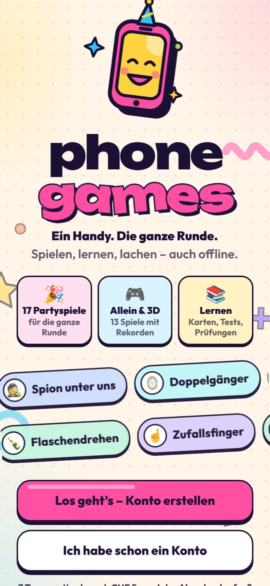
  
  
  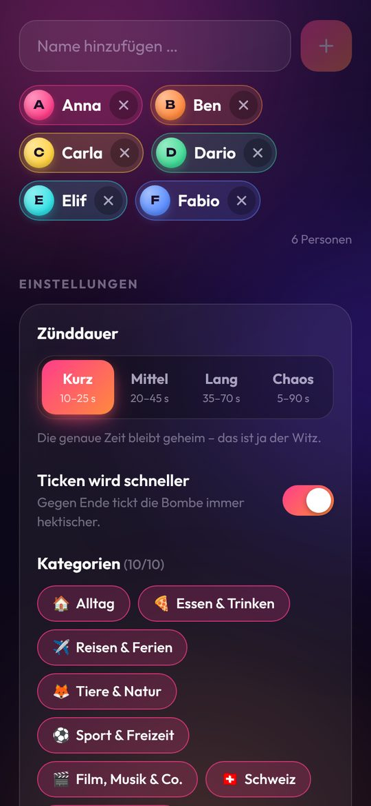
</p>
<p align="center">
  
  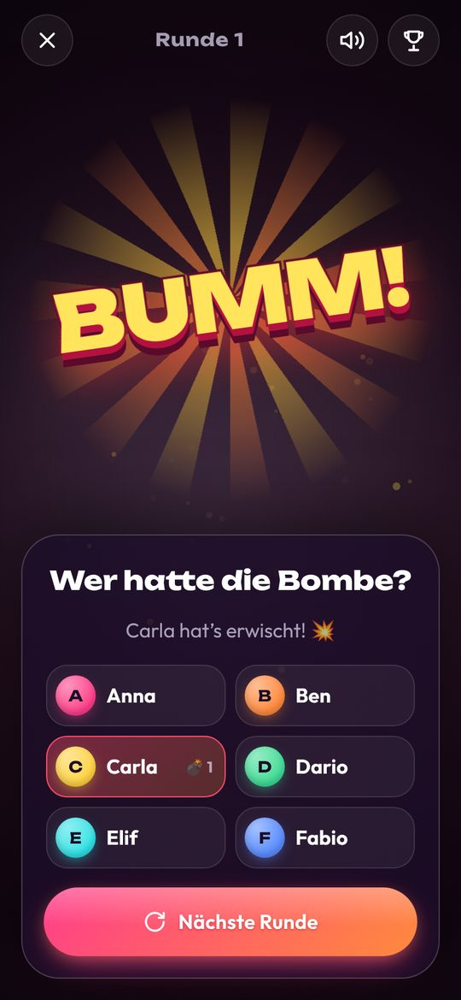
  
  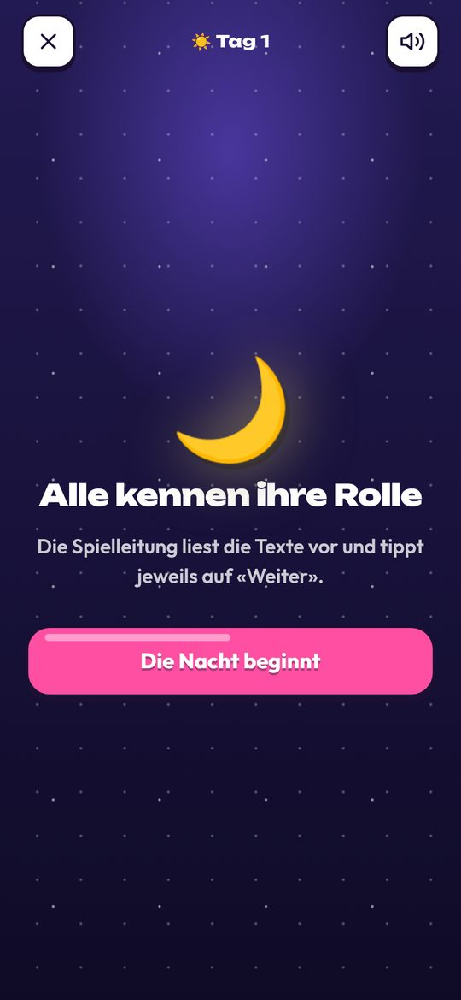
</p>
<p align="center">
  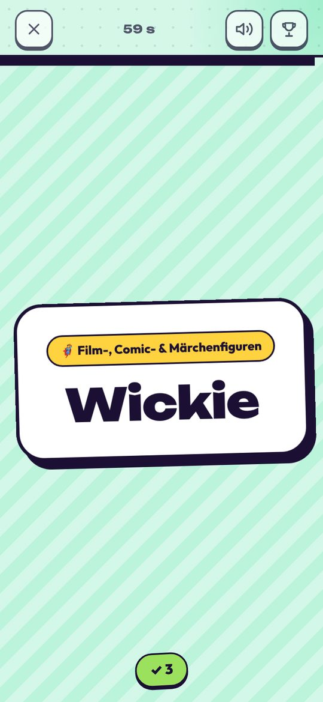
  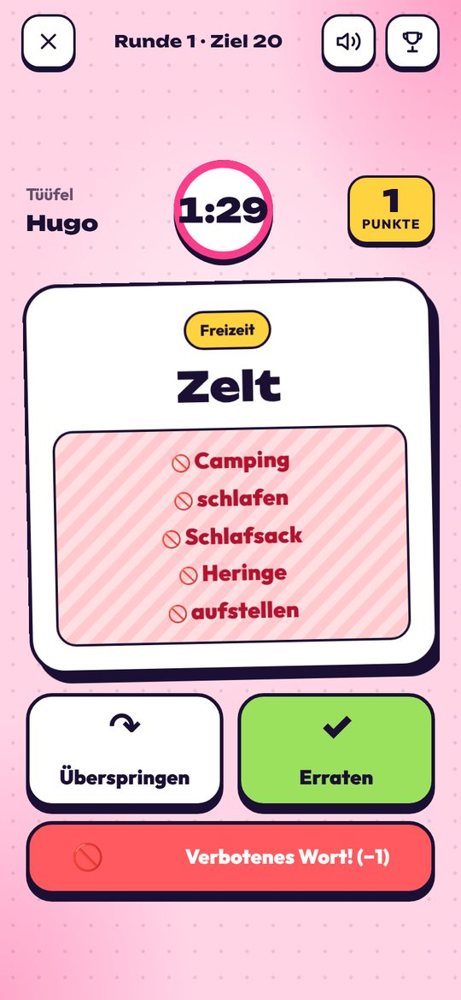
  
  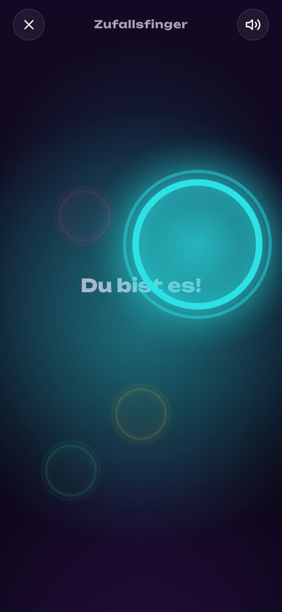
</p>
<p align="center"><b>📝 Spickzettel – Schulstoff als Spiel</b></p>
<p align="center">
  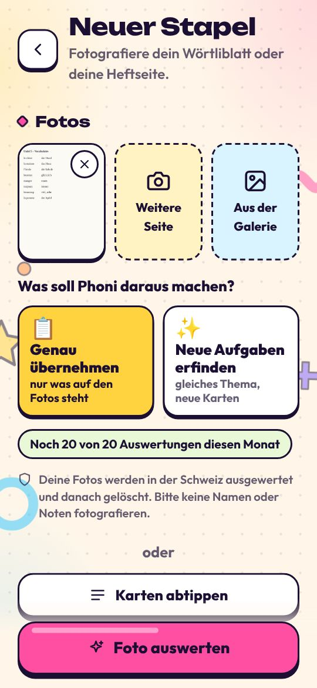
  
  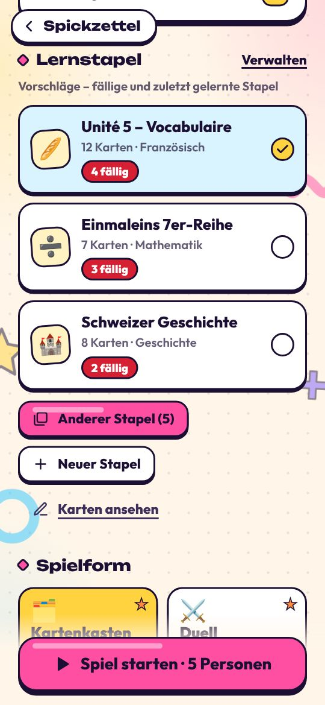
  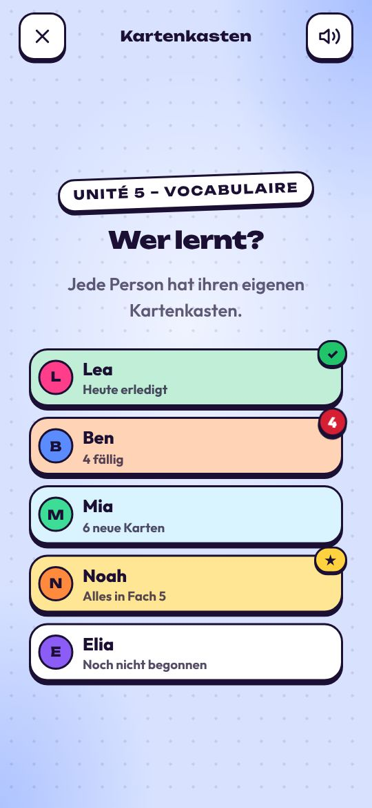
</p>
<p align="center">
  
  
  
  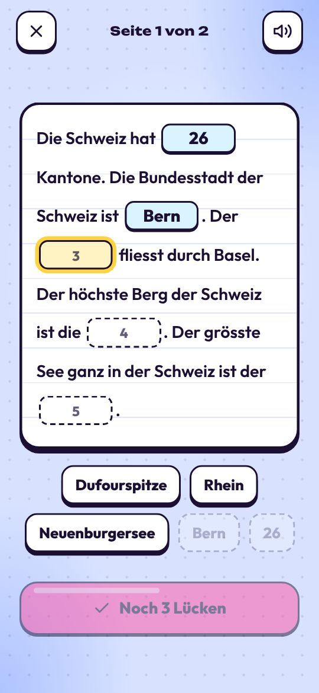
</p>

## Funktionen

| Bereich | Was es kann |
| --- | --- |
| **Start** | «Weiterspielen» mit dem zuletzt gespielten Spiel und der Gruppe · kompakte Kacheln für «Meine Spiele» · Vorschläge zum direkten Hinzufügen |
| **Konto** | Registrieren mit Name, E-Mail und Passwort – vorerst nur mit Einladungscode (auch als Link `/registrieren?code=…`) · Anmelden/Abmelden · **Passkeys** (Face ID, Fingerabdruck, Geräte-PIN) einrichten, verwalten und damit anmelden – Hinweis auf dem Startbildschirm, der sich dauerhaft wegklicken lässt · Name, E-Mail, Avatar (Emoji + Farbe) und Passwort ändern · Datenexport (JSON) · Konto löschen |
| **Entdecken** | «Spiel des Tages» · Filter «Wie viele seid ihr?» · Volltextsuche (umlaut-tolerant) und Kategorien · Spiele mit einem Tipp hinzufügen/entfernen |
| **Spielgruppen** | Gruppen mit Namen, Symbol und Mitspielenden anlegen · beim Spielstart wird die Gruppe angezeigt und kann direkt angepasst werden (Personen hinzufügen/entfernen) |
| **Spiele** | 17 Partyspiele mit über 2’500 Begriffen, Fragen und Karten und ein Lernspiel – siehe Tabelle unten |
| **Lernstapel** | Lernstoff per Foto erfassen (bis 6 Seiten; Auswertung mit einem Qwen-Modell bei Infomaniak in der Schweiz, Fotos werden nicht gespeichert) oder abtippen · erkannte Karten prüfen und korrigieren · Monatslimit pro Person · Stapel und Lernstand werden synchronisiert · **per Link teilen** (der Link gilt als Einladung, Empfänger übernehmen eine eigene Kopie) |
| **Sound & Stimme** | Eigenes Sounddesign pro Spiel (Trommelwirbel, Herzschlag, Fanfaren …, alles synthetisiert) · natürliche Erzählstimmen «Thorsten» und «Kerstin» vom eigenen Server (Piper) – auf jedem Gerät gleich, auch auf dem iPhone, Ansagen offline verfügbar; sonst die beste Stimme des Geräts · Stimmenauswahl mit Hörprobe unter Konto → Erzählstimme |
| **PWA** | Installierbar (Android & iOS) · komplett offline spielbar · Offline-Änderungen werden automatisch synchronisiert · Update-Hinweis bei neuer Version · Bildschirm bleibt während des Spiels an |

## Die Spiele

| Spiel | Personen | Worum es geht |
| --- | --- | --- |
| 💣 **Bombe** | 2–30 | Frage beantworten, Handy weitergeben – bis es knallt. Geheime Zündzeit, Ticken wird schneller, Partikel-Explosion. 300+ Fragen |
| 🕵️ **Spion unter uns** | 3–12 | Alle kennen geheim den Ort – nur der Spion nicht. Fragen stellen, bluffen, entlarven. 56 Orte mit Rollen |
| 🪞 **Doppelgänger** | 3–16 | Alle haben dasselbe Wort, einer ein ähnliches. Wer fällt auf? 179 Wortpaare, «Ahnungslos»-Modus |
| 🐺 **Nachts im Dorf** | 5–20 | Werwolf-Spiel – das Handy ist Spielleitung und führt mit Sprachausgabe durch die Nacht. Seherin & Beschützer, Rollen bleiben bis zum Schluss geheim |
| 🤔 **Wer bin ich?** | 2–16 | Handy an die Stirn, die anderen erklären. Kippen = erraten/passen (Bewegungssensor). 9 Themen, 500+ Begriffe |
| 🎭 **Pantomime** | 4–20 | Teams, Zeitlimit, drei Schwierigkeitsstufen. 311 Begriffe |
| 🤐 **Verbotene Wörter** | 4–20 | Erklären ohne die fünf naheliegenden Wörter – mit Buzzer fürs Gegnerteam. 210 Karten |
| 🎩 **Hutspiel-Marathon** | 4–20 | Eigene Begriffe, drei Runden: erklären, ein Wort, Pantomime |
| 🎨 **Zeichnen & Raten** | 3–16 | Mit dem Finger zeichnen, die anderen raten. Farben, Pinsel, Radierer, Rückgängig. 307 Begriffe |
| 🎵 **Summ-Raten** | 4–20 | Lieder summen, das Team rät. 267 Lieder von Kinderliedern bis Mundart-Hits |
| 🎯 **Schätzmeister** | 2–12 | Geheim schätzen, spannende Auflösung, Punkte für die Nächsten. 102 Fragen |
| ⚖️ **Mehr oder weniger** | 1–12 | Matterhorn oder Kilimandscharo – was ist höher? 15 Themen mit geprüften Werten |
| 👉 **Wer würde eher …?** | 3–30 | Auf «3» zeigen alle auf eine Person. 170 Fragen in drei Paketen |
| 🔥 **Wahrheit oder Pflicht** | 2–20 | Roulette wählt, Wahrheit oder Pflicht? 192 Karten, Pakete von Familie bis Party |
| 🙋 **Ich hab noch nie …** | 3–30 | Wer schon hat, steht auf – mit Strichliste. 168 Aussagen |
| ☝️ **Zufallsfinger** | 2–10 | Alle Finger aufs Display: eine Person, zwei Teams oder eine Reihenfolge auslosen |
| 🍾 **Flaschendrehen** | beliebig | Wischen und drehen lassen – auf Wunsch mit Wahrheit-oder-Pflicht-Karte |
| 📝 **Spickzettel** | 1–30 | Lernspiel mit eigenen Lernstapeln: **Kartenkasten** (Lernkartei mit 5 Fächern, Lernstand pro Person; selbst prüfen, Auswahl aus vier oder eintippen), **Duell** (zu zweit, geteilter Bildschirm, wer zuerst richtig tippt), **Blitzrunde** (Teams, eine Person fragt ab), **Schätzrunde** (Zahlen und Jahreszahlen, alle schätzen geheim) und **Lückentext** (Wortbank oder eintippen) |

Alle Inhalte sind in Schweizer Hochdeutsch geschrieben (ohne «ß») und funktionieren offline.

## Design & Marke

- **Phoni**, das fröhliche Handy-Maskottchen, ist Logo und Gastgeber zugleich: Es begrüsst, staunt bei leeren Listen,
  feiert mit Partyhut und schaut verdutzt, wenn etwas schiefgeht ([`client/src/components/Brand.tsx`](client/src/components/Brand.tsx)).
- **Sticker-Pop-Look:** warmes Creme-Papier mit Punktraster, kräftige Farben, dicke Konturen, harte Schatten,
  leicht schräge «Sticker»-Elemente und schwebende Formen im Hintergrund
  ([`client/src/styles/global.css`](client/src/styles/global.css)).
- **Knöpfe zum Draufdrücken:** Alles Klickbare senkt sich beim Antippen spürbar ein – mit Vibration und Sound.
- **Spiele:** helle, farbige Bühnen pro Spiel; bewusst dunkel sind nur die Nacht im Dorf und der Knall der Bombe.

## Technik

- **Frontend:** React 19, TypeScript, Vite 8, React Router 7, Zustand, `vite-plugin-pwa` (Workbox)
- **Backend:** Node.js 24, Fastify 5, SQLite über das eingebaute `node:sqlite` (keine nativen Abhängigkeiten), Zod
- **Sound & Effekte:** Web Audio API (alle Sounds werden zur Laufzeit erzeugt), Erzählstimme mit [Piper](https://github.com/OHF-Voice/piper1-gpl) im eigenen Container bzw. Web Speech API, Canvas (Explosion, Konfetti, Zeichenfläche), CSS-Animationen, View Transitions
- **Geräte-APIs:** Bewegungssensor (Kipp-Steuerung), Multi-Touch, Vibration, Wake Lock, Kamera/Fotos (Lernstapel)
- **KI:** Foto-Auswertung für Lernstapel über die OpenAI-kompatible Schnittstelle der Infomaniak AI Tools (Rechenzentren in der Schweiz), festes JSON-Schema
- **Betrieb:** Docker, Caddy (automatisches HTTPS mit Let’s Encrypt), GitHub Actions → GitHub Container Registry → Infomaniak VPS

## Schnellstart (Entwicklung)

Voraussetzung: **Node.js ≥ 22.18** (empfohlen: 24, siehe `.nvmrc`).

```bash
npm ci
```

```bash
npm run dev
```

Danach läuft die App auf <http://localhost:5173> (Vite mit Hot Reload), die API auf Port 3000. Vite leitet `/api` automatisch an die API weiter.
Die SQLite-Datenbank liegt in `./data/phonegames.db`.

Produktionsbuild lokal testen (inkl. Service Worker / Offline-Modus):

```bash
npm run preview
```

→ <http://localhost:3000>

### Skripte

| Befehl | Zweck |
| --- | --- |
| `npm run dev` | API-Server (mit Watch) + Vite-Dev-Server |
| `npm run build` | PWA nach `dist/client` bauen |
| `npm start` | Produktionsserver starten (liefert API **und** PWA aus) |
| `npm run preview` | Build + Produktionsserver |
| `npm test` | Tests (Vitest): API, Sync-Logik, Spiellogik und Inhalte |
| `npm run test:e2e` | Browser-Tests (Playwright): baut die App und spielt die wichtigsten Abläufe auf einem Handy-Bildschirm durch – siehe [`e2e/`](e2e) |
| `npm run typecheck` | TypeScript-Prüfung |
| `npm run icons` | App-Icons aus `client/public/icons/phoni.svg` neu erzeugen |

## Projektstruktur

```
├── client/                 PWA (React)
│   ├── public/             Icons, Favicon
│   └── src/
│       ├── components/     UI-Bausteine (Buttons, Sheets, Roulette, Spieler-Editor …)
│       ├── games/          Spiele – je Spiel ein Ordner + registry.ts
│       │   ├── shared/     Spielrahmen, Timer, Weitergeben & Aufdecken, Teams, Team-Engine …
│       │   ├── bombe/      Fragen, Logik, Timer, Sounds, Explosion, Grafik
│       │   └── …           16 weitere Spiele mit Logik und Inhalten
│       ├── lib/            API-Client, Sync, Audio, Konfetti, PWA, Geräte-APIs
│       ├── pages/          Seiten (Willkommen, Spiele, Entdecken, Gruppen, Konto, Spiel)
│       ├── store/          Zustand-Stores (Auth, Daten, Einstellungen, UI)
│       └── styles/         Design-System (CSS)
├── server/                 API (Fastify + SQLite)
│   ├── src/                app.ts, routes/, repo.ts (Datenbank), security.ts …
│   └── test/               API-Tests
├── e2e/                    Browser-Tests (Playwright) mit eigenem Testserver und Schein-KI
├── shared/                 Typen und Sync-Logik für Client und Server
├── deploy/                 docker-compose.yml, Caddyfile, setup-vps.sh, backup.sh
├── docs/                   Dokumentation
├── .github/workflows/      CI und Deployment
└── Dockerfile
```

## Deployment

Jeder Push auf `main` wird getestet, als Docker-Image in die GitHub Container Registry gepusht und per SSH auf den
Infomaniak-VPS ausgerollt. Die Schritt-für-Schritt-Anleitung (VPS bestellen, DNS, SSH-Schlüssel, GitHub-Secrets,
Backups, Rollback) steht in **[docs/DEPLOYMENT.md](docs/DEPLOYMENT.md)**.

## Weitere Dokumentation

- [docs/DEPLOYMENT.md](docs/DEPLOYMENT.md) – Infomaniak-VPS einrichten und mit GitHub Actions ausrollen
- [docs/ARCHITEKTUR.md](docs/ARCHITEKTUR.md) – Aufbau, Offline-Synchronisation, Sicherheit, API
- [docs/SPIELE.md](docs/SPIELE.md) – Ein neues Spiel hinzufügen · Bausteine · Inhalte ergänzen
- [docs/KONZEPT-LERNSTAPEL.md](docs/KONZEPT-LERNSTAPEL.md) – Konzept und Etappen des Lernspiels «Spickzettel»
